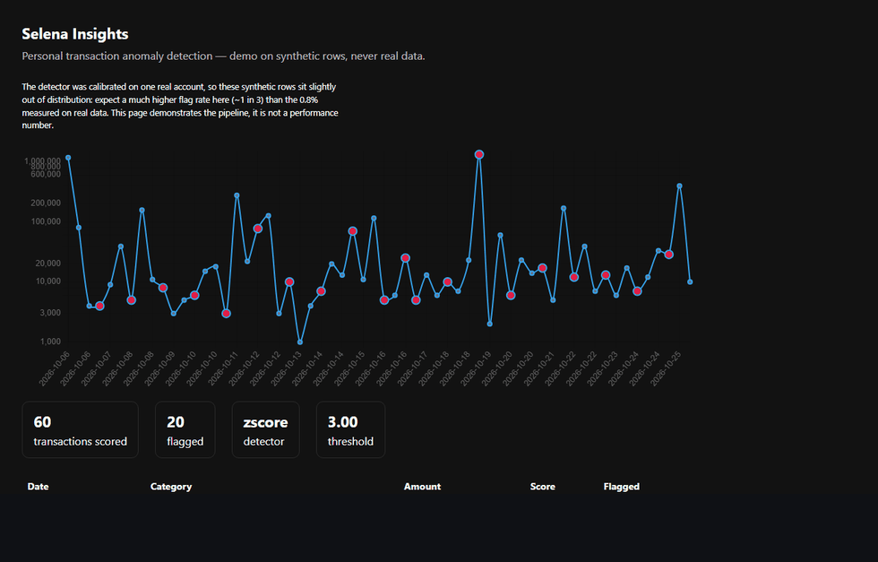

# Selena Insights

[](https://github.com/drafi19/selena-insights/actions/workflows/ci.yml) [](LICENSE)

Personal transaction anomaly detection: a rebuilt ML pipeline from my Bangkit capstone, evaluated
honestly, served over HTTP, and running on my own wallet data.

## Ringkasan (ID)

Repo ini adalah re-implementasi pribadi komponen ML dari capstone Bangkit "Selena" - aplikasi
pencatat keuangan. Isinya: pipeline data yang reproducible, tiga detektor anomali yang diadu dengan
protokol yang sama, evaluasi berlabel sintetis + review manual, dan API yang bisa dipanggil.
Datanya rekening Wallet saya sendiri (read-only), bukan data tim. Hasil utamanya justru jujur:
**autoencoder kalah dari z-score** di 251 transaksi, dan itu ditulis apa adanya.

## Status

Data layer, model, evaluation and the scoring API all work, the repo is public, and the service
is live: **https://selena-insights.onrender.com**

```bash
curl -s https://selena-insights.onrender.com/health
# {"status":"ok","model_version":"v0.3.0","detector_default":"zscore","features":7}
```

It runs on Render's free tier, so it sleeps after 15 minutes idle and the first request afterwards
pays a ~50 s cold start. Once awake it answers in ~250 ms; the model itself takes ~30 ms.



*Rendered from the live service, not a mock. The demo rows are synthetic and deliberately labelled
as out of distribution - a 33% flag rate on them is not a performance number.*

Start here: **[case study](docs/CASE_STUDY.md)** · [model card](docs/MODEL_CARD.md) ·
[why the autoencoder lost](reports/ablation.md) ·
[blog: the model lost to a z-score](docs/blog/01-model-saya-kalah-dari-z-score.md)

## Results

Pooled over 20 injection replicates (760 labels, 10.5% positive), test set 38 rows, calibrated at
a 1% false-positive rate:

| Detector | PR-AUC | ROC-AUC | Recall @ FPR 1% |
|---|---|---|---|
| Autoencoder, 6 features | 0.170 | 0.598 | 0.025 |
| Autoencoder, 7 features (+ category) | 0.154 | 0.570 | 0.025 |
| z-score | 0.296 | 0.791 | 0.138 |
| IsolationForest | 0.318 | 0.762 | 0.037 |

Chance level is 0.105. **The autoencoder loses.** On a 10,000-row synthetic corpus with ~7,000
training rows it beats both baselines (PR-AUC 0.215 vs 0.173), so the gap is sample size - 175
training rows cannot support 1,839 parameters. Adding a category-relative feature did not help on
real data; that negative ablation is published in `reports/ablation.md`.

Serving therefore defaults to the detector that won on evidence, not the one with the better
resume: `detector` is part of every API response (`docs/adr/0002-detector-choice.md`).

### The only human-labelled number

I reviewed the top 30 flags myself: **4 were genuinely unusual, 26 were normal - precision@30 =
0.133** (`reports/manual_review_summary.md`). Three of the four sit at 3.05, barely above the 3.0
threshold, and 25 of the 30 flags are driven by `days_since_prev` rather than by the amount: the
detector mostly notices long gaps between transactions, and a gap is a holiday, not an anomaly.
That is the honest state of v0.3.0 and the starting point for v0.4.

## How it works

1. **Data** - Wallet REST API (read-only), then four filters: transfers between my own accounts,
   the lending ledger, income, and zero-amount placeholders. Result: 251 spending rows from 567
   records over 92 days (`data/README.md`).
2. **Features** - seven, all causal (row *i* only sees rows <= *i*): log amount, day of week, day
   of month, month, days since previous transaction, rolling z-score of amount, rolling z-score
   within the same category.
3. **Detectors** - autoencoder (7-32-16-8-16-32-7) plus two baselines, each with its own threshold
   calibrated on a clean holdout at 1% FPR.
4. **Labels** - none exist, so anomalies are injected with a fixed seed (spike, duplicate,
   round-number burst, micro-drip) and metrics are pooled across 20 replicates.
5. **Serving** - the model is exported to ONNX; FastAPI keeps pandas for features and onnxruntime
   for inference, so the container does not need torch.

## Run it

```bash
uv sync
uv run python -m selena_ml.data.wallet_client      # read-only pull, needs ~/.wallet/token.txt
uv run python -m selena_ml.data.prepare            # transfer / lending / income filtered out
uv run python -m selena_ml.train --out artifacts/v0.3.0 --version v0.3.0
uv run python -m scripts.export_onnx --artifact artifacts/v0.3.0
uv run python -m scripts.eval_protocol --artifact artifacts/v0.3.0
uv run uvicorn selena_ml.serve.app:app --port 8000
```

```bash
curl -s localhost:8000/health
curl -s -X POST localhost:8000/score -H 'content-type: application/json' \
  -d '{"transactions":[{"date":"2026-01-01","amount":20000,"category":"Coffee"},
                       {"date":"2026-01-02","amount":900000,"category":"Groceries"}]}'
```

`/score` returns one row per input, in input order, with `detector`, `threshold`, `score` and
`is_anomaly`. `/` serves a dashboard on synthetic rows; `/metrics` returns the offline numbers.

Latency, in-process benchmark (50 rows/request, 100 requests): **p50 27 ms, p95 41 ms**. Most of
it is pandas feature building, not the model.

## Reproduce every check

```bash
bash scripts/verify_all.sh
```

Actual output on a clean clone (no private data present):

```
== 1/4 lint
== 2/4 tests
== 3/4 serving smoke (no private data needed)
health: {"status": "ok", "model_version": "v0.3.0", "detector_default": "zscore", "features": 7}
scored 10 demo rows with detector=zscore, threshold=3.000, flagged=3
smoke ok
== 4/4 SKIPPED: data/processed/spending.parquet not present (private Wallet export).
```

With the private export in place, stage 4 instead trains a fresh artefact, exports ONNX, re-runs
the evaluation protocol and the ablation, ending with `done: reports/repro/eval.md`. Nothing in
this repo requires that file to be readable by anyone else.

## Repo layout

```
selena_ml/data/     wallet client, filters, loader, simulator, anomaly injection
selena_ml/          features, scaling, baselines, autoencoder, train, evaluate
selena_ml/serve/    pydantic schema + FastAPI app
scripts/            audit, eval protocol, ONNX export, ablation, benchmark, deploy
reports/            generated eval + ablation (never hand-edited)
artifacts/v0.3.0/   model.pt, model.onnx, scaler.json, zscore.json, threshold.json, metadata.json
docs/               model card, ADR, bug write-up, security note, wallet audit
```

## Limitations

1. **One person, 92 days.** No cross-user generalisation is claimed or possible.
2. **Labels are synthetic.** The metrics measure sensitivity to injected patterns, not real fraud.
3. **Manual logging.** Transactions I did not record do not exist in the series.
4. **Heavy tail.** Big purchases are normal for me, so magnitude is a weak signal; "unusual for me
   but ordinary in size" anomalies will be missed.
5. **38-row test set.** Every per-replicate number is noisy, which is why the protocol pools
   replicates instead of quoting one run.

## Credits and scope of this work

The original Selena capstone was a seven-person Bangkit team project
([drafi19/Selena-App](https://github.com/drafi19/Selena-App), a fork of
[itsmaul/Selena-App](https://github.com/itsmaul/Selena-App)):

- Machine Learning: Amin Afif Rafi'i, Risma Auliya Salsabilla, Calista Salsabila Citra Putri Winanto
- Cloud Computing: Afridho Ikhsan, Rizki Septiana
- Mobile Development: Aditya Daffa Syahputra, Ajeng Puspa Andini

**What this repository is:** my own re-implementation of the ML component, written after the
programme, with a different data source, a different tech stack and an evaluation protocol the
original never had. **What it is not:** the team deliverable. The Android app and the Node/Express
backend were built by the CC and MD members; none of their code is included here, and the GCP
deployment was theirs, not mine. The original notebook is not republished either.

That boundary is also why this repo uses my own wallet data: the capstone dataset mixed three
teammates' bank statements with a public Kaggle dump, and permission to republish it cannot be
obtained.

## License

MIT - see `LICENSE`.

## What is missing

- Nothing blocking the repo itself. The Hugging Face Space is unused because Docker Spaces now
  return **402 Payment Required** on a free account; `render.yaml` is what actually deployed.
- 30 hand-reviewed flags for a human-labelled precision number (`scripts.review_flags` produces
  the CSV; the review itself is manual).
- A demo GIF.
